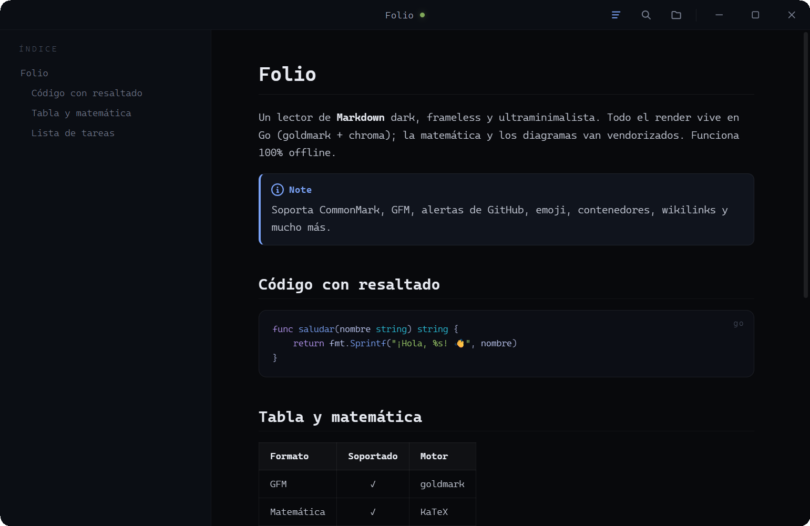

<p align="right"><sub><b>English</b> · <a href="README.md">Español</a></sub></p>

<div align="center">

# Folio

**A dark, frameless, ultra-minimal document reader for Windows.**

Markdown by birth, plus **126 more extensions**: JSON, CSV, YAML, reStructuredText, AsciiDoc, Org,
Jupyter, Word, EPUB and all the code chroma knows how to highlight. All the rendering lives in Go — no
Electron, no browser, no CDN. A single portable `.exe`.


[](https://github.com/agustinyarrus/folio/releases/latest)
[](https://github.com/agustinyarrus/folio/releases)



</div>

---

## ✨ What it is

**Folio** is a minimalist document viewer: you open it, it reads beautifully, it gets out of your way. A single
**WebView2 window without the system frame** — the page itself draws the title bar and the buttons.
**Go** turns the Markdown into HTML (goldmark + chroma) compiled into the `.exe`; the math
(KaTeX) and the diagrams (mermaid) are vendored. **It works 100% offline** and starts in ~0.5 s.

## 📚 Formats

Folio doesn't only read Markdown. Everything else **is converted to Markdown** and goes through the same engine,
so it inherits the table of contents, the search, the highlighting and the typography without a single special case.

| Group | Formats | What it does |
|---|---|---|
| **Markdown** | `md` `markdown` `mdown` `mkd` `mdx` `rmd` `qmd` … | the native path (see below) |
| **Data** | `json` `jsonc` `json5` `jsonl` `ndjson` `csv` `tsv` `yaml` `toml` `ini` `env` `xml` `plist` | an array of objects and a CSV come out as a **real table**: columns in the file's order, numbers right-aligned, the CSV delimiter is detected on its own (`,` `;` `\t` `\|`). A JSON with comments (tsconfig, VS Code settings, JSON5) is shown **as is**, comments included; only minified JSON is reformatted |
| **Markup** | `rst` `adoc` `asciidoc` `org` `wiki` `mediawiki` `html` `htm` `xhtml` | headings, lists, emphasis, code, links, images, **tables** (reST grid and simple tables, AsciiDoc `\|===`, Org, MediaWiki `{\|`), **footnotes** and admonitions (`.. note::` → alert) |
| **Documents** | `docx` `odt` `epub` `ipynb` | Word and OpenDocument with bold, links (HYPERLINK fields too), nested lists, tables and footnotes; the EPUB is assembled chapter by chapter with its internal links working; the notebook with its outputs, formulas, images and errors |
| **Code** | `go` `py` `js` `ts` `c` `cpp` `rs` `java` `cs` `rb` `php` `sh` `ps1` `sql` … | highlighted per language: **everything chroma recognizes**, which is ~250 |
| **Text** | `txt` `log` `nfo` `diff` `patch` | as is, with its formatting preserved (and the `diff` colored) |

`.docx`, `.odt` and `.epub` files are a ZIP with XML inside: they're read with `archive/zip` and `encoding/xml`
from the standard library. Images that live inside the document are embedded as `data:`
URIs. **Not a single new dependency** for all of this.

<sub>Details: a file with a BOM or in UTF-16 (everyday stuff on Windows) is decoded on its own; a
binary with a text extension hangs nothing, it shows a hex dump; and if a converter
fails, you see the raw content instead of an error.</sub>

## 🧩 And in Markdown, "every flavor"

- Full **CommonMark** + **GFM**: tables, strikethrough, autolinks, task lists.
- **GitHub-style alerts**: `> [!NOTE]`, `[!TIP]`, `[!IMPORTANT]`, `[!WARNING]`, `[!CAUTION]` with icon and color.
- **Emoji** by shortcode: `:tada:` → 🎉 (real Unicode, offline).
- **Inline marks** (Pandoc / markdown-it): `==highlighted==`, `++inserted++`, `x^2^`, `H~2~O`.
- **Wikilinks** (Obsidian): `[[Page]]`, `[[Page|alias]]`, `[[Page#section]]` and embedded images `![[photo.png|300]]`, looked up in the vault the way Obsidian does it.
- **Containers** (Pandoc / VuePress): `::: warning … :::`, nestable, with their own title.
- **Abbreviations** (Markdown Extra): `*[HTML]: HyperText Markup Language`.
- **Embedded Markdown**: a ` ```markdown ` block is rendered formatted inside its box.
- **Heading IDs** like GitHub's (`#configuración-del-índice`, accents included), or your own with `{#my-anchor}`; footnotes, definition lists, typography, YAML frontmatter.
- **Code highlighting** per language (chroma, Tokyo Night palette) with a copy button.
- **Math** `$...$` / `$$...$$` (KaTeX) and **diagrams** ```mermaid```.

## 🎛️ Features

- Auto-generated side **table of contents (TOC)**, with **draggable width** and the active section highlighted. **It folds into an 18 px rail** with one mark per heading (the length tells the level, the section you're reading is blue): hover it and the TOC peeks out floating over the text, without moving it, and picking a heading tucks it away again. Chevron in the panel, `T`, or the bar button; remembered between sessions.
- **Live reload**: edit the `.md` in any editor and the view updates on its own (SSE) **without moving you off the paragraph you were reading**, even if the change is above it. It waits for the editor to finish saving and doesn't repaint if the content didn't change.
- In-page **search** (Ctrl F or `/`) that ignores accents and case ("accion" finds "Acción"), also across formatting ("**Folio** is"), highlighted through the CSS Custom Highlight API.
- **Reading zoom** (Ctrl ±) remembered between sessions.
- **Fullscreen**, **single instance** (opening a 2nd file reuses the live window), drag and drop.
- Windows 11's native rounded corners and dark border.
- **Truly local only**: the internal server only answers to its own address (`127.0.0.1:port`), so a web page can't use DNS rebinding to read files from your disk through it.

## ⌨️ Shortcuts

| Key                  | Action                          |
|----------------------|---------------------------------|
| `Ctrl O`             | Open a document                 |
| `Ctrl F` / `/`       | Search (`Enter` / `Shift+Enter`, `n` / `N`)|
| `T`                  | Fold/unfold the TOC (`Esc` closes the preview) |
| `Ctrl ±` / `Ctrl+wheel` | Font size (remembered)       |
| `F` / `F11`          | Fullscreen                      |
| `g` / `G`            | Go to top / bottom              |
| `Space` / `PgUp/Dn`  | Scroll                          |

## 📦 Installation

> Requires [**Go**](https://go.dev) 1.24+ to build and the **WebView2 runtime** (it ships with Windows 11).

```powershell
git clone https://github.com/agustinyarrus/folio.git
cd folio
.\build.ps1      # builds folio.exe (release, no console, with icon)
.\install.ps1    # installs to Program Files + Start Menu and associates it with .md (UAC)
```

The installer makes itself the **default only for `.md`** files and their variants. Everything else
(`.json`, `.csv`, `.docx`, `.go`…) is only added to the **"Open with"** menu: Folio doesn't steal
the associations from your editor or from Word.

The icons are curated assets in the repo: **`folio.ico`** (the app icon, embedded in the `.exe` at
build time) and **`folio-file.ico`** (the icon of `.md` documents, through the `Folio.Document` ProgID). The
optional script `.\gen-icon.ps1` regenerates the original glyph and **overwrites `folio.ico`**.

`.\install.ps1 -Uninstall` reverts the installation. Or just run the `.exe`:

```powershell
folio.exe ruta\al\documento.md
```

## 🏗️ Architecture

| File             | Role                                                                   |
|------------------|------------------------------------------------------------------------|
| `main.go`        | Frameless host + local HTTP server + single instance + live reload     |
| `render.go`      | goldmark pipeline: TOC, code (chroma), links, frontmatter              |
| `formats.go`     | Format catalog, detection and conversion to Markdown                   |
| `fmt_data.go`    | JSON, JSON Lines, CSV/TSV, YAML/TOML/INI, XML, code and plain text     |
| `fmt_markup.go`  | reStructuredText, AsciiDoc, Org, MediaWiki, HTML                       |
| `fmt_docs.go`    | Jupyter, Word (.docx), OpenDocument (.odt) and EPUB                    |
| `htmlmd.go`      | Our own HTML parser (no dependencies) and its conversion to Markdown   |
| `alerts.go`      | GitHub-style alerts (`> [!NOTE]`…)                                     |
| `inline_ext.go`  | Inline marks `==mark==`, `++ins++`, `^sup^`, `~sub~`                   |
| `wikilink.go`    | Wiki links `[[Page]]`                                                  |
| `abbr.go`        | Abbreviations `*[KEY]: …` → `<abbr>`                                   |
| `containers.go`  | Containers `::: name … :::`                                            |
| `mathext.go`     | Our own `$...$` / `$$...$$` extension                                  |
| `winapi.go`      | Native open dialog, fullscreen                                         |
| `ui/`            | Embedded HTML + CSS + JS (`//go:embed`) and vendored libraries         |

## 📄 License

MIT © Agustín Yarrus — see [LICENSE](LICENSE).

<!-- i18n source=README.md sha256=4b7754917333 -->
